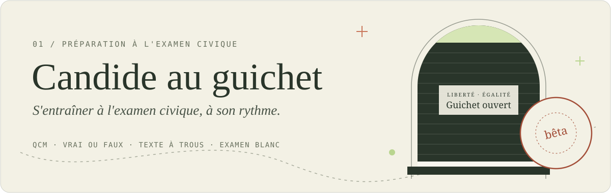
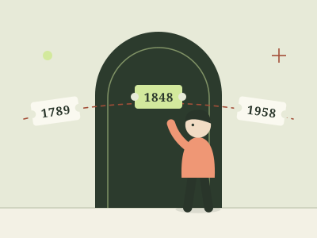
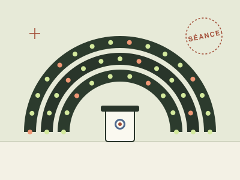
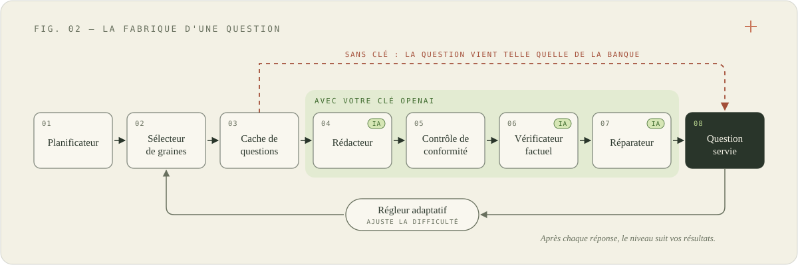

<p align="center">
  
</p>

<p align="center">
  <a href="#avertissement"></a>
  <a href="#contribuer"></a>
  <a href="https://app.codecov.io/gh/AnotherDataGuy/candidequizz"></a>
  <a href="https://www.gnu.org/licenses/agpl-3.0"></a>
  <a href="https://shiny.posit.co/"></a>
  
</p>

> [!WARNING]
> **Version en cours de développement.** Les questions ont été relues, mais elles n'ont pas encore toutes été testées
> en conditions réelles : certaines peuvent contenir des erreurs, des imprécisions ou des informations dépassées.
> Cette application est un outil d'entraînement parmi d'autres ; elle ne remplace pas les
> [sources officielles](https://www.service-public.gouv.fr/particuliers/vosdroits/F39426). Vos retours sont les bienvenus.

> **In English —** *Candide au guichet* (R package `candidequizz`) is a small, independent Shiny app to practise for the
> French civic exam (*examen civique*). It is an **early, in-development version**: the question bank is still being
> tested and may contain mistakes. It works offline without any API key; with your own OpenAI key, AI agents can
> rewrite and check questions from the bank. The interface is in French.

---

## Ce que fait l'application

<table>
  <tr>
    <td align="center" width="25%"><br /><sub><b>Histoire</b></sub></td>
    <td align="center" width="25%"><br /><sub><b>Institutions</b></sub></td>
    <td align="center" width="25%"><br /><sub><b>Citoyenneté</b></sub></td>
    <td align="center" width="25%"><br /><sub><b>Europe</b></sub></td>
  </tr>
</table>

- **Entraînement** : des séances de 10 à 60 questions, avec correction immédiate ou à la fin.
- **Révision ciblée** : l'application repère les sous-thèmes fragiles et y revient.
- **Examen blanc** : 40 questions, 45 minutes, seuil de 32 bonnes réponses, corrections à la fin.
- **Cinq types de questions** : QCM à réponse unique ou multiple, vrai ou faux, remise en ordre, texte à trous
  (sans IA : QCM de la banque).
- **Difficulté adaptative** : le niveau suit vos réponses.
- **Progression** : un carnet de suivi par thème, par séance et dans le temps.
- **Ressources** : des liens vers les sources officielles, et huit grands thèmes présentés dès l'accueil.

## Démarrage rapide

Il faut [R](https://cran.r-project.org/) (4.4 ou plus récent).

```r
# install.packages("remotes")
remotes::install_github("AnotherDataGuy/candidequizz")

candidequizz::run_app()
```

L'application s'ouvre dans votre navigateur, **sans compte** : vos séances restent sur votre ordinateur. Elle
fonctionne entièrement **sans IA**, avec la banque de questions.

## Activer l'IA (facultatif)

Avec votre propre clé OpenAI, l'application peut réécrire des questions à partir de la banque et proposer les autres
types de questions.

1. En composant une séance, choisissez **« Avec IA »** (étape 2).
2. Collez votre clé et cliquez sur **« Utiliser cette clé »**.
3. Pas encore de clé ? Le lien **« Obtenir une clé en 4 étapes »** explique comment en créer une.

Les appels sont facturés sur **votre** compte OpenAI. La clé reste en mémoire le temps que l'application est ouverte ;
elle n'est jamais enregistrée par l'application. Pour ne pas la recoller à chaque fois, ajoutez
`OPENAI_API_KEY=sk-...` dans un fichier `.Renviron` (modèle : `.Renviron.example`) et redémarrez R.

Une question écrite par l'IA est vérifiée par un second agent, mais cette vérification n'est pas infaillible : gardez
un œil critique.

## Comment sont écrites les questions

Chaque question part d'une *graine* de la banque pédagogique
(`inst/extdata/banque_donnees_questions_reponses.xlsx` : 584 graines, 8 thèmes, 39 sous-thèmes ; la colonne
`OFFICIAL_THEME` rattache chaque graine à l'un des 5 thèmes officiels de l'examen). Elle passe ensuite par une
chaîne d'étapes ; celles marquées « IA » ne servent qu'avec votre clé OpenAI :

<p align="center">
  
</p>

La banque est un classeur Excel publié avec le code, pour que chacun puisse la relire, la réutiliser ou proposer une
correction.

## Données et vie privée

- Vos séances et vos réponses restent **sur votre ordinateur** (un fichier SQLite dans le dossier utilisateur de R).
- Avec l'IA, sont envoyés au modèle : le contenu pédagogique des graines, pour écrire et vérifier les questions, et
  des statistiques de séance déjà agrégées, pour le bilan. Rien d'autre.

## Configuration

<details>
<summary>Variables d'environnement (facultatives)</summary>

| Variable | Rôle |
|---|---|
| `OPENAI_API_KEY` | Votre clé OpenAI. Sans elle, l'application la demande quand vous choisissez « Avec IA ». |
| `CANDIDEQUIZZ_PRESET` | Modèles utilisés : `economique`, `equilibre` (défaut) ou `qualite`. |
| `CANDIDEQUIZZ_STORE_DIR` | Dossier des données (par défaut, le dossier utilisateur de R). |
| `CANDIDEQUIZZ_STORE_BACKEND` | `sqlite` (défaut) ou `rds`. |

Les réglages pédagogiques (tailles de lot, seuils adaptatifs, examen blanc, cache) sont dans
`inst/golem-config.yml`. Les liens de la section Ressources sont dans `inst/extdata/ressources.yml`, et les textes des
fenêtres de thèmes dans `inst/extdata/themes.yml` : ces fichiers se modifient sans toucher au code.

</details>

<details>
<summary>Développer</summary>

Ouvrez `candidequizz.Rproj` dans RStudio, puis :

```r
pkgload::load_all()
run_app()

devtools::test()   # tests
```

```
R/
  agent_*.R      agents de la chaîne de génération
  fct_*.R        logique (banque, séances, stockage, statistiques, IA)
  mod_*.R        modules Shiny (accueil, séances, progression, ressources)
  qtype_*.R      types de questions (affichage, notation, validation)
inst/
  app/www/       styles, scripts, illustrations
  extdata/       banque de questions, ressources, thèmes
  prompts/       consignes des agents IA
tests/testthat/  tests
```

</details>

## Pourquoi cette application

Candide est né d'une idée simple : se préparer à l'examen civique devrait être clair, vérifiable et accessible à
tous. Trois principes guident le projet.

**Savoir où l'on en est.** Réviser, c'est bien ; savoir ce qu'on a révisé, c'est mieux. Chaque séance est
enregistrée : les thèmes travaillés, les bonnes et les mauvaises réponses, l'évolution d'une séance à l'autre. On voit
ce qui est acquis et ce qui coince encore, et la révision ciblée revient d'elle-même sur les points fragiles.

**Garder la main sur ce qu'on apprend.** Apprendre une réponse fausse, c'est pire que de ne pas la connaître. Chaque
question est relue et, autant que possible, accompagnée d'une source officielle que chacun peut consulter. La banque
est un simple fichier Excel, ouvert à tous : on peut la vérifier, la corriger et l'améliorer.

**Mettre des outils au service de l'intérêt général.** Les outils de développement et de suivi statistique servent
d'habitude à suivre des indicateurs ; ici, ils servent à suivre une préparation. Le projet est gratuit et libre, pour
que chacun puisse en profiter.

C'est un projet bénévole, encore en construction. Si une question vous semble fausse ou peu claire, dites-le : c'est
comme ça qu'elle deviendra meilleure.

## Contribuer

Le projet a surtout besoin de **testeurs**. Une question fausse, ambiguë ou dépassée ?
[Ouvrez une issue](https://github.com/AnotherDataGuy/candidequizz/issues) en indiquant l'identifiant de la question
et, si possible, une source officielle.

## Avertissement

Application indépendante et bénévole, en cours de développement, **sans lien avec aucun organisme
public**. Elle ne garantit ni l'exactitude de toutes les questions ni la réussite à l'examen. En cas de
doute, les [sources officielles](https://www.service-public.gouv.fr/particuliers/vosdroits/F39426) font foi.

## Licence

[AGPL-3](LICENSE.md) © L. Gabriel Cruz Saavedra - [@anotherdataguy](https://github.com/AnotherDataGuy)
